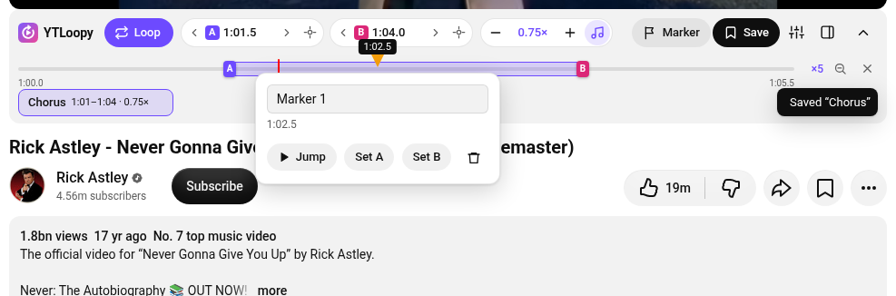
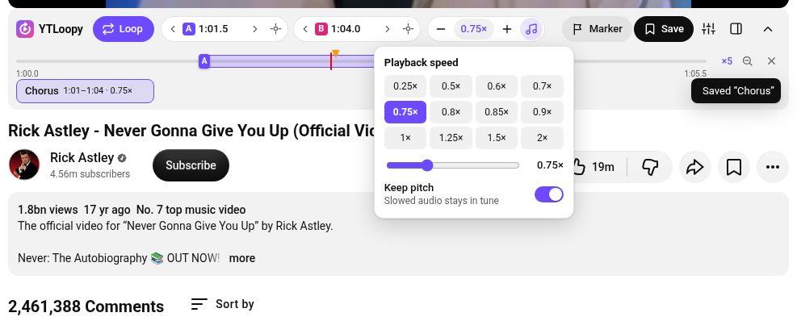
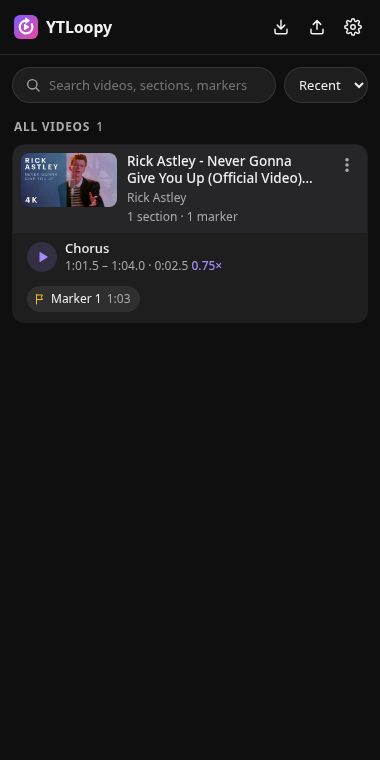
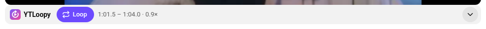

<p align="center"></p>
<h1 align="center">YTLoopy</h1>
<p align="center">Loop, slow down and bookmark sections of YouTube videos. Built for practising music.</p>

YTLoopy adds a slim practice bar under the YouTube player. Mark where a passage starts and ends, it loops right away,
slow it down without changing the pitch, and save it to a library you can come back to (and export, back up or share).



## Features

- **A–B looping** with clean repeats (checked every frame, not just a few times a second).
- **Speed control** from 0.25× to 2× in 0.05× steps, with presets and a slider. A loop's speed stays with the loop:
  turning the loop off or clearing it, or opening another video, goes back to your normal YouTube speed.
- **Keep pitch** toggle (on by default): slowed audio stays in tune. Turn it off for a tape-style pitch drop.
- **Mini timeline** with draggable A/B handles, drag-to-select a loop, snapping to markers, and **zoom to loop** for precise edges.
- **Markers**: drop one at the current time, rename it, jump to it, or use it as A or B.
- **Saved sections**: name and save a loop with its speed. They appear as chips under the player and in the library.
- **Practice options**: a pause before each repeat, and a **speed trainer** that raises the speed as you repeat.
- **Library side panel**: search, sort, play any saved section (opens the video and starts looping), rename, delete with undo.
- **Export / import** your library as JSON. Importing merges and never deletes anything. You can also export a single video.
- **Keyboard shortcuts** that avoid YouTube's own keys, and that you can rebind.
- Follows YouTube's light and dark themes. Collapses to a single line when you just want to watch.

| Speed | Library | Collapsed |
| --- | --- | --- |
|  |  |  |

## Install (Chrome, Edge, Brave, Opera, Vivaldi, any Chromium browser)

1. Download `ytloopy-<version>.zip` from the [latest release](../../releases/latest) and unzip it
   (or clone this repository).
2. Open `chrome://extensions` (Edge: `edge://extensions`, Brave: `brave://extensions`).
3. Turn on **Developer mode**.
4. Click **Load unpacked** and pick the unzipped folder (the one that contains `manifest.json`).
5. Pin YTLoopy from the puzzle-piece menu so the library is one click away.

## Updating

Your library is kept when you update, as long as you **replace the files and reload** rather than removing the extension:

1. Download the new zip and unzip it, either over your existing YTLoopy folder or into a new folder.
2. In `chrome://extensions`, click the reload icon on YTLoopy. If you used a new folder, click **Load unpacked** and pick it; it replaces the old copy and keeps your data.
3. Don't click **Remove**. Chrome deletes an extension's data when it's removed.

Keep a backup anyway: **Export** in the library saves everything to a file, and the library reminds you once you've
saved a few sections. Backups from any version import into any later version.

> **Coming from 1.0.0 or 1.0.1?** Those versions had no fixed extension ID, so moving to 1.1.0 needs a one-time
> export and import: open the old YTLoopy library, click **Export**, then load 1.1.0 and click **Import**.
> From 1.1.0 on, updates keep your data automatically.

## How to use

1. Open a YouTube video. The YTLoopy bar sits right under the player.
2. Press <kbd>[</kbd> where the passage starts and <kbd>]</kbd> where it ends. It starts looping.
3. Slow it down with <kbd>-</kbd> (and back up with <kbd>=</kbd>), or click the speed for presets.
4. Fine-tune: drag the A/B handles, use the ‹ › buttons (0.1 s, Shift for 1 s), scroll over a time, or type one (`1:23.4`).
5. Click **Save** to keep it. Click the toolbar icon (or the panel button in the bar) to open your library.

| Key | Action |
| --- | --- |
| <kbd>[</kbd> | Set loop start (A) |
| <kbd>]</kbd> | Set loop end (B) and start looping |
| <kbd>\\</kbd> | Loop on / off |
| <kbd>'</kbd> | Jump to loop start |
| <kbd>-</kbd> / <kbd>=</kbd> | Slower / faster |
| <kbd>;</kbd> | Add a marker |

Shortcuts can be changed in the library's settings. They're ignored while you type in a text field.

## Privacy

Everything stays in your browser (`chrome.storage.local`). YTLoopy makes no network requests of its own and has no
analytics. Permissions: `storage`, `sidePanel`, and access to `www.youtube.com` only.

## Development

No build step: the extension runs straight from this folder.

```bash
npm test             # unit tests (node --test)
npm run icons        # re-render icons/*.png from icons/logo.svg (needs rsvg-convert)
npm run package      # build dist/ytloopy-<version>.zip
```

- `src/content/` – the practice bar, loop engine and keyboard handling (injected into YouTube).
- `src/sidepanel/` – the library, import/export and settings.
- `src/shared/` – storage, data model, time helpers and icons used by both.
- `docs/spec.md` – the design spec.
- `docs/versioning.md` – how stored data survives updates, and how to add migrations for new features.

## License

MIT
